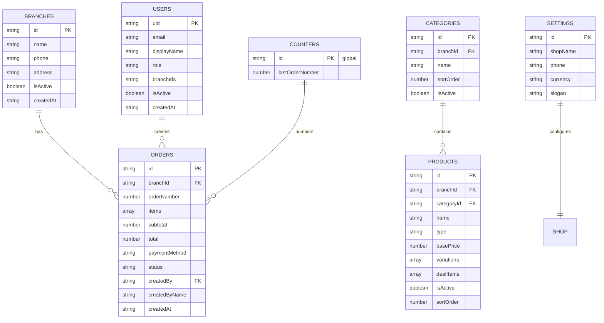

# Brovo Bites POS — ERD

## Entity relationship

## Product types

- **simple** — single `basePrice` (burgers, drinks)
- **sized** — `variations[]` with label + price (pizza S/M/L/XL, fries)
- **bundle** — deal `basePrice` + `dealItems[]` labels for kitchen

## Multi-branch

New shop = new `branches` doc. The menu (categories + products) is shared by all branches — their `branchId` is the legacy value `"shared"`.  
Orders, expenses, inventory and cash drawers are scoped by the real `branchId`.  
Order numbers come from one global counter (`counters/global`), shared by all branches.  
Counter users get `branchIds: [thatBranch]`. Owner sees all.
